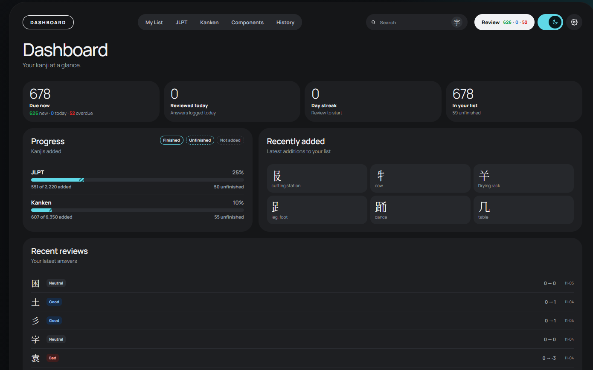
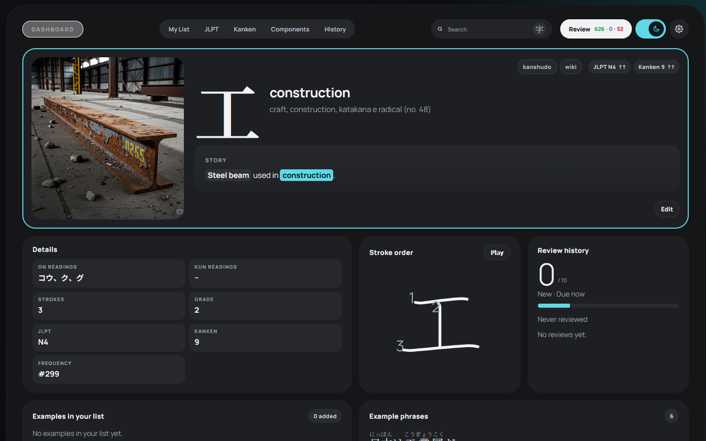
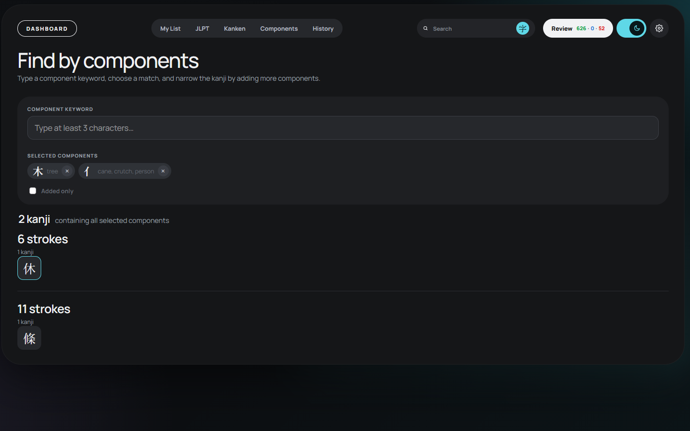
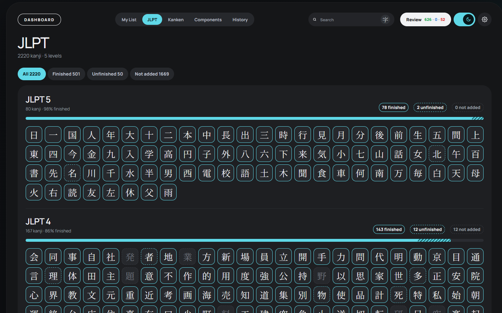
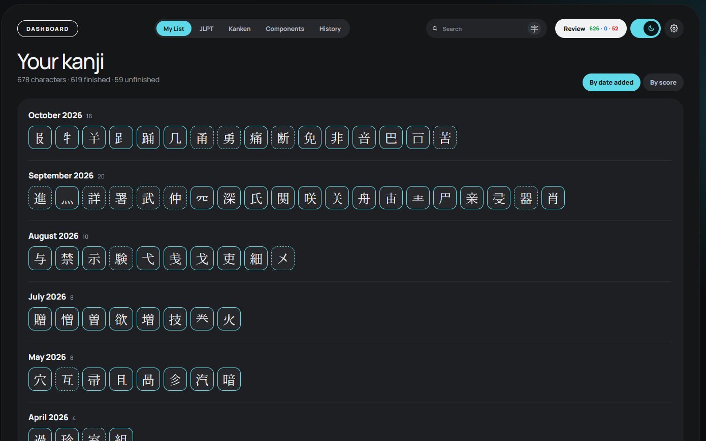
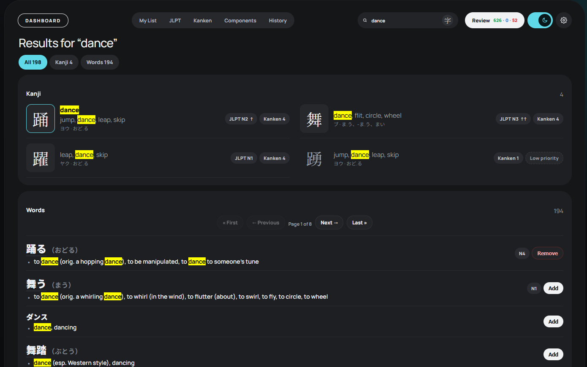

# KanjiApp

A personal project for studying kanji and managing mnemonics.

It is a small, self-hosted, server-rendered web app that runs on top of your own SQLite databases. A small Bun server in `server.ts` serves the pages, with the logic and views in `src/` and the stylesheet, scripts and fonts in `public/` — no build step, no framework, no account, no cloud. Your list, scores, history and mnemonics live in `data/user.db`; dictionary and kanji reference data live in `data/reference.db`; example phrases live in `data/phrases.db`; the kanji pictures live in `data/images/`.

## Screenshots

<table>
<tr>
<td width="50%"><a href="docs/screenshots/dashboard.png"></a><br><sub><b>Dashboard</b></sub></td>
<td width="50%"><a href="docs/screenshots/kanji-page.png"></a><br><sub><b>Kanji detail</b></sub></td>
</tr>
<tr>
<td width="50%"><a href="docs/screenshots/find-by-component.png"></a><br><sub><b>Find by components</b></sub></td>
<td width="50%"><a href="docs/screenshots/jlpt-list.png"></a><br><sub><b>JLPT list</b></sub></td>
</tr>
<tr>
<td width="50%"><a href="docs/screenshots/my-list.png"></a><br><sub><b>My list</b></sub></td>
<td width="50%"><a href="docs/screenshots/search.png"></a><br><sub><b>Word search</b></sub></td>
</tr>
</table>

## What you can do with it

**Search and browse.** Look up kanji by character, keyword, meaning, reading or romaji, with readings, components, JLPT/Kanken levels, frequency and example words; words are searchable too. Text searches need two characters, but a single kanji or kana is enough for a direct lookup. The **字** button opens a component search: type a component keyword, select matching components, and see every kanji that contains all of them. **My List** groups what you are studying by date or score, and the JLPT and Kanken pages show every level as a grid.

**Write and edit.** Adding a kanji takes a click. Every entry has a story field for your mnemonic with simple formatting (`=keyword=`, `_component_`, `?note?`, `#link#`), rendered while you type with a code toggle for the raw markers, and the keyword, components, related forms, flags and image are edited on the same page.

**Review and measure.** A simple spaced-repetition system moves each kanji's score and uses it to pick the next interval; the queue is split into new, due today and overdue. Answer with the buttons, the keyboard (`Space` to reveal, `A S D F` to answer) or a controller (`A` to reveal, `LT LB RB RT` to answer), and watch the dashboard stats for the list size, the due queue, the level trend and the answer mix.

**Screenshots.** Upload screenshots of Japanese text; each one appears on the page of every kanji it contains, with the Japanese and optional English text available as an overlay or carousel. Autofill can use the optional [KanjiApp OCR](https://github.com/andres-foo/kanji-app-ocr) companion service: a standalone local PaddleOCR backend that accepts raw JPEG bytes and returns recognized Japanese lines with confidence scores and bounding boxes. It has no UI, translation, database or image storage, and the app works without it.

**Make it yours.** Light and dark themes, editable review deltas and mastery-level names, and a reset that returns every added kanji to the starting score.

### Search tips

Word searches support positional wildcards:

| Pattern | Meaning |
|---|---|
| `*日` | words ending in 日 |
| `日*` | words starting with 日 |
| `*日*` | words containing 日 |
| `+日` | at least one character before 日 |
| `日+` | at least one character after 日 |
| `+日+` | at least one character on both sides |

`*` matches zero or more characters and `+` matches one or more. Wildcards apply to Japanese word spellings and readings.

In the main search bar, press **Tab** to cycle between romaji and hiragana:

```text
taberu → たべる → taberu → たべる
```

The next form is previewed below the search field. Pressing **Tab** again keeps cycling without moving focus.

## Quick start

    bun run start                                  # http://localhost:3000
    DB_PATH=/path/to/user.db REFERENCE_DB_PATH=/path/to/reference.db PHRASE_DB_PATH=/path/to/phrases.db IMAGES_DIR=/path/to/images PORT=3000 bun run start

- `DB_PATH` (default `./data/user.db`): the SQLite user database. It holds the study list, stories, scores, history, settings and word additions.
- `REFERENCE_DB_PATH` (default `./data/reference.db`): the read-only core reference database. It holds the kanji dictionary data and the word tables. The app does not write to it.
- `PHRASE_DB_PATH` (default `./data/phrases.db`): the read-only example phrase database. It holds the Tatoeba phrases and furigana. The app does not write to it.
- `SCREENSHOTS_DB_PATH` (default `./data/screenshots.db`): the separate screenshot library database.
- `SCREENSHOTS_DIR` (default `./data/screenshots`): full screenshots and their `thumbs/` thumbnails.
- `OCR_URL` (default `http://127.0.0.1:8765`): optional KanjiApp OCR service; the app remains usable when it is offline.
- `IMAGES_DIR` (default `./data/images`): one image per kanji, named after the character (`水.jpg` or `水.png`). Square images look best; they are picked up on the next page load.
- No dependencies: `bun:sqlite` is built in.

## Project layout

| Path | Contents |
|---|---|
| `server.ts` | the Bun server: static and font routes, the URL dispatch table, startup |
| `src/` | the app logic — config, database, HTML helpers, search, settings, mastery, review, stats, images, story |
| `src/views/` | the HTML for each page: layout, home/dashboard, lists, kanji, review, settings and charts |
| `src/routes/` | the POST handlers: kanji edit/toggle, images, theme/details, review answers, settings |
| `public/` | the stylesheet, browser scripts and the Jigmo fonts |
| `data/` | `user.db`, `reference.db`, `phrases.db`, `screenshots.db`, kanji pictures and screenshots |
| `docs/` | screenshots used in this README |

Assumptions the app makes:
- `frequency` and `freq_wiki` are ranks (1 = most common), so lower sorts first.
- `jlpt` is 1 to 5 (shown as N1 to N5) and `kanken` is shown as-is.

## Overview

Search for a kanji, add it to your list, write a short mnemonic, and let the review queue bring it back when it is due. Each answer moves the score, the score picks the next interval, and the dashboard shows how the list is doing. That is the app in one loop: find, add, write, review, repeat.


## Scoring and review system

Every kanji in your study list (`added = 1`) has a **score**. The score does not decide *which* kanji comes next. It decides **when the kanji is due again**: each answer moves the score up or down, and the new score is looked up in a table of intervals (in days) to set the next due date. Anything due today or earlier is waiting in the review queue.

In short:

```
answer  →  new score  →  interval for that score  →  due date = today + interval
```

---

### 1. Key concepts

| Term | Meaning |
|---|---|
| **Score** | A whole number from **-3 to 10** stored in `kanjis.score`. A new kanji starts at **0**. |
| **Mastery level** | A named band of scores (Weak, New, Learning, Familiar, Strong, Mastered). Shown at the top of the kanji page together with the score and the time until the next review (green = not scheduled yet, blue = due today, red = overdue). |
| **Interval** | How many days until the kanji is due again. It depends only on the score the kanji has *after* the answer. |
| **Due date** | `kanjis.due_date`, a `YYYY-MM-DD` date. Empty (`NULL`) means "never scheduled", which counts as due now. |
| **Queue** | All added kanji with an empty due date or a due date of today or earlier. The dashboard splits it into **new** (no due date), **due today** and **overdue**. |
| **Review counter** | The numbers in the navbar, `Review (new · today · overdue)`, coloured green, blue and red. Together they are the size of the queue right now. |

---

### 2. The score scale and mastery levels

The scale and the days are stored in the `mastery_levels` table (`score`, `label`, `interval_days`). These are the defaults. You can rename the labels and change the days on the **Settings** page.

| Score | Mastery level | Days until next review |
|---:|---|---:|
| -3 | Weak | 1 |
| -2 | Weak | 1 |
| -1 | Weak | 1 |
| 0 | New | 1 |
| 1 | Learning | 1 |
| 2 | Learning | 2 |
| 3 | Learning | 3 |
| 4 | Familiar | 4 |
| 5 | Familiar | 6 |
| 6 | Familiar | 8 |
| 7 | Strong | 12 |
| 8 | Strong | 16 |
| 9 | Strong | 20 |
| 10 | Mastered | 25 |

Notes:

- If a row is missing from `mastery_levels` (or the table does not exist), the app uses the built-in default for that score, so a review never fails because of it.
- The scale itself (-3 to 10) is fixed in the code. The floor and ceiling in the settings can only narrow it, never widen it.

---

### 3. The four answers

On the answer page there are four buttons. Each one changes the score by the amount in the `settings` table, then keeps the result between the **floor** and the **ceiling**.

| Button | Setting key | Default change | Next due date |
|---|---|---:|---|
| **Bad** | `review_delta_bad` | -3 | **Today.** The kanji stays in the queue and comes back this session. |
| **Neutral** | `review_delta_neutral` | 0 | Today + interval of the (unchanged) score |
| **Good** | `review_delta_good` | +1 | Today + interval of the new score |
| **Easy** | `review_delta_easy` | +2 | Today + interval of the new score |

The formula:

```
after    = clamp(before + change, floor, ceiling)
due_date = today                       if the answer was Bad
         = today + interval(after)     otherwise
```

Details:

- `before` is the kanji's score when you pressed the button. An empty score counts as 0.
- The interval is counted **from today**, not from the old due date. Reviewing a kanji late does not shorten or stretch the next interval.
- Bad always makes the kanji due today, whatever the interval table says.
- At the floor (-3), Bad cannot lower the score further. The answer is still saved in the history and the kanji still comes back today.
- At the ceiling (10), Good and Easy cannot raise the score further, but the kanji is still rescheduled with the 25-day interval.

---

### 4. Settings

Values live in the `settings` table (`key`, `value`, stored as text). If a row is missing or is not a number, the default is used.

| Key | Default | Meaning | Editable on Settings page? |
|---|---:|---|---|
| `review_score_floor` | -3 | Lowest score a kanji can have | No (database only) |
| `review_score_ceiling` | 10 | Highest score a kanji can have | No (database only) |
| `review_score_start` | 0 | Score given when a kanji is added, and the value **Reset scores** sets | No (database only) |
| `review_delta_bad` | -3 | Score change for Bad | Yes |
| `review_delta_neutral` | 0 | Score change for Neutral | Yes |
| `review_delta_good` | 1 | Score change for Good | Yes |
| `review_delta_easy` | 2 | Score change for Easy | Yes |
| `phrase_results_per_kanji` | 5 | Example phrases shown initially on a kanji page | Yes |

Also on the Settings page: the **mastery levels** (label and days for every score) and the red **Reset scores** button.

Notes:

- The floor and ceiling are clamped to the -3 to 10 scale. If the floor is set higher than the ceiling, the two are swapped.
- The starting score is clamped between the floor and the ceiling.
- Score changes must be whole numbers from -10 to 10. Days must be whole numbers from 1 to 3650.

---

### 5. The review flow, step by step

| Step | What you do | What the app does | Saved? |
|---|---|---|---|
| 1 | Click **Review (N)** in the navbar (`/review`) | Picks the next kanji from the queue and redirects to `/review/<kanji>` | **Nothing** |
| 2 | Look at the question page | Shows the big kanji and the added example words that contain it | Nothing |
| 3 | Click **Show answer** | Opens the normal kanji page with `?review=1`, which shows the four answer buttons | Nothing |
| 4 | Press **Bad / Neutral / Good / Easy** | Updates the score and dates, writes a row to `review_history`, redirects to `/review` | **Yes** |
| 5 | (automatic) | `/review` picks the next kanji, back to step 2 | Nothing |

Important:

- **Only pressing an answer button records anything.** Visiting `/review`, loading a question page, or pressing **Review** in the navbar to skip a kanji changes nothing: the kanji stays due and can come back.
- The pick is made fresh each time. Among kanji that tie completely (see below), the choice is random, so reloading `/review` can show a different kanji.
- When nothing is due, `/review` shows "Nothing to review right now" and tells you how many kanji are due on the next date.
- An answer applies to whichever kanji page you pressed it on.
- **Keyboard and controller, desktop only.** Keyboard: **Space** shows the answer, then **A** Bad, **S** Neutral, **D** Good, **F** Easy. Controller: **A** shows the answer, **LT** Bad, **LB** Neutral, **RB** Good, **RT** Easy. The hints follow whichever device was used last, and the chosen answer lights up for a moment before the page continues. With a touch screen (no mouse or trackpad) the hints are hidden and the shortcuts are off, so the buttons behave as before.

---

### 6. Which kanji comes next

The queue is every kanji with `added = 1` and (`due_date` empty **or** `due_date <= today`). The next kanji is chosen by this order:

| Priority | Sort | Effect |
|---:|---|---|
| 1 | `due_date` ascending, empty first | Never-scheduled kanji first, then the most overdue |
| 2 | `last_reviewed` ascending, empty first | Among equals, the one reviewed longest ago |
| 3 | `score` ascending | Among equals, the weakest |
| 4 | Random | Final tie-break |

Because of this order, a kanji you just answered Bad on (due today, reviewed today) sorts **after** kanji that were due on earlier days, so it comes back once the older ones are done, not instantly.

There is no daily limit. You can keep reviewing for as long as the queue has kanji.

---

### 7. Adding, removing and resetting

| Action | Where | Score | Due date / last reviewed |
|---|---|---|---|
| **Add** a kanji that was not added | **Added** checkbox in the edit form, or the Add button on a search result row | Set to the starting score (default 0) | Cleared, so it is due immediately |
| **Remove** a kanji | Untick **Added**, or the Remove button on a search row | **Kept** | Kept |
| **Re-add** a kanji that was removed | Same as Add | **Reset** to the starting score | Cleared |
| **Reset scores** | Red button on the Settings page (asks for confirmation) | Every added kanji set to the starting score | Cleared for every added kanji, so all are due now |

Notes:

- A removed kanji is no longer in the queue (the queue only contains `added = 1`), even though its score is kept.
- Reset scores only touches added kanji. The review history is not changed.
- The **Unfinished** and **Is component** checkboxes in the edit form are saved exactly as shown. The Add/Remove buttons on search rows also set `unfinished` automatically (on when adding, off when removing).

---

### 8. Review history

Every answer adds one row to `review_history`. Rows are never deleted: it is a permanent log.

| Column | Content |
|---|---|
| `id` | Row number |
| `kanji` | The kanji reviewed |
| `date` | Local date and time of the answer (`YYYY-MM-DD HH:MM:SS`) |
| `before` | Score before the answer |
| `after` | Score after the answer (after clamping to the floor and ceiling) |
| `type` | `bad`, `neutral`, `good` or `easy` |

The dashboard stats only count rows whose `type` is one of those four values.

---

### 9. Worked example

A new kanji, using the default settings:

| Day | Answer | Score before | Change | Score after | Interval | Next due |
|---:|---|---:|---:|---:|---|---|
| 1 | Good | 0 | +1 | 1 | 1 day | Day 2 |
| 2 | Easy | 1 | +2 | 3 | 3 days | Day 5 |
| 5 | Good | 3 | +1 | 4 | 4 days | Day 9 |
| 9 | Easy | 4 | +2 | 6 | 8 days | Day 17 |
| 17 | **Bad** | 6 | -3 | 3 | **today** | Day 17 (again) |
| 17 | Good | 3 | +1 | 4 | 4 days | Day 21 |

A new kanji you do not recognise:

| Answer | Score before | Change | Score after | Next due |
|---|---:|---:|---:|---|
| Bad | 0 | -3 | -3 | Today (Weak) |
| Bad | -3 | -3 | -3 (floor) | Today |
| Good | -3 | +1 | -2 | Tomorrow (1 day) |
| Good | -2 | +1 | -1 | Tomorrow |
| Good | -1 | +1 | 0 | Tomorrow |
| Good | 0 | +1 | 1 | Tomorrow, then it is Learning |

From the floor, three Goods get a kanji back to 0.

---

### 10. Dashboard stats

The stats section at the bottom of the Dashboard (`/`) is built from the review history and the current state of your list. Choose 30 days, 90 days or 6 months above it.

The dashboard cards at the top show the list size, the queue split into **New · no due date** (green), **Due today** (blue) and **Overdue** (red), reviewed today, the current streak, and finished / total counts. Below that, the longer-range section shows:

| Section | What it shows |
|---|---|
| **Kanji by level** | A stacked chart of how many kanji sit at each mastery level on each day, rebuilt from the `after` scores in the history |
| **Coming up** | A stacked **Now** column (green new / blue due today / red overdue), then how many kanji are already scheduled for each of the next 14 days |
| **Answers by level** | For each score: number of reviews, split of Bad / Neutral / Good / Easy, the **Not bad** percentage and a verdict |

Definitions:

- **Due states**: **new** = `due_date` is empty (never scheduled, so it is due immediately), **due today** = `due_date` is the server's local date, **overdue** = `due_date` is earlier. The three together are the queue.
- **Not bad** = every answer except Bad (Neutral + Good + Easy) divided by all answers.
- **Level** in the answers table is the score the kanji had *before* the answer, since that is the interval that was just tested.
- **Verdict** for each level, to help you tune the intervals:

| Condition | Verdict | Suggestion |
|---|---|---|
| Fewer than 30 reviews | Not enough data | Wait for more reviews |
| Not bad below 80% | Too hard | Shorten the interval of this score |
| Not bad from 80% to 95% | About right | Leave it |
| Not bad above 95% | Too easy | Lengthen the interval of this score |

A kanji is reviewed at score *s* because it was scheduled with the interval of score *s*, so the answers at that level are the best test of that interval. Reviews that happen the same day as a Bad answer are counted too, so the lowest levels can look harsher than their interval alone.

---

### 11. Things to know

- **Dates use the server's local date.** Due dates and the queue use `date('now', 'localtime')`. If the app runs on a server set to another timezone (many hosts use UTC), reviews in the evening can land on the next day. Set the server's timezone (for example `TZ=America/Santiago`).
- **Database columns.** Reviewing needs `user_kanjis.score`, `user_kanjis.last_reviewed` and `user_kanjis.due_date`, and the tables `review_history`, `settings` and `mastery_levels` in `user.db`. If a column is missing, review pages show an error naming it.
- **`added_at` is recorded when a kanji is added through the edit form.** Older rows may not have a timestamp; the dashboard stats chart then counts that kanji for the whole period.
- **Old history.** Reviews saved before the 0-to-10 scale (and the four-button system) used different score meanings. They are still in `review_history` and will skew the dashboard stats for periods that reach back that far.
- **The priority colours are separate.** The green / orange / red / grey backgrounds on JLPT and Kanken badges depend only on how many kanji are added, finished and not components. They have nothing to do with review scores.
- **Backups.** `user.db` is the only copy of your scores, stories and history. Copy it somewhere else regularly, and before using **Reset scores**. Back up `reference.db` after adding custom component kanji. `phrases.db` is replaceable reference data.

---

## Credits

Confirmed sources used by this app:

### Dictionary data

Word headwords, readings, meanings, parts of speech and alternative spellings are derived from **EDICT2/JMdict**, copyright © James William Breen and the Electronic Dictionary Research and Development Group (EDRDG).

Kanji reference data is derived from [**KANJIDIC2**](https://www.edrdg.org/wiki/index.php/KANJIDIC_Project), also copyright © James William Breen and the EDRDG.

Both sets of data are stored here as modified SQLite transformations and are used under [CC BY-SA 4.0](https://www.edrdg.org/edrdg/licence.html).

### JLPT kanji levels

Kanji JLPT levels for 2,220 kanji come from the [Nihongo-Pro Kanji Pal JLPT lists](https://www.nihongo-pro.com/kanji-pal/list/jlpt). These are unofficial study lists; the JLPT does not publish an official kanji list.

### Kanken levels

Kanken levels for 6,350 kanji come from [Kanjikana's Kanken level lists](https://kanjikana.com/en/kanji/kanken). These are third-party study lists; check the source page for its current terms and attribution requirements.

### Word JLPT levels

Word JLPT levels come from the [Tanos JLPT vocabulary lists](https://www.tanos.co.uk/jlpt/) by Jonathan Waller, licensed under Creative Commons BY. The import uses the [Bluskyo CSV conversion](https://github.com/Bluskyo/JLPT_Vocabulary). These are unofficial study lists; the JLPT does not publish an official vocabulary list. Levels are stored separately in `word_jlpt`. Words that do not have a confident Tanos match, or that have conflicting Tanos levels, have no assigned JLPT level.

### Example phrases

Example sentences and English translations come from [Tatoeba](https://tatoeba.org/), released under [CC BY 2.0 FR](https://creativecommons.org/licenses/by/2.0/fr/). The import keeps the first English translation for each Japanese sentence. Furigana is generated at the token level with SudachiPy and stored with `furigana_checked = 0` until it is reviewed.

### Word frequency

An earlier word-frequency enrichment used the [Wiktionary Japanese 2022 frequency lists](https://en.wiktionary.org/wiki/Wiktionary:Frequency_lists/Japanese2022_10000) ([1–10,000](https://en.wiktionary.org/wiki/Wiktionary:Frequency_lists/Japanese2022_10000) and [10,001–20,000](https://en.wiktionary.org/wiki/Wiktionary:Frequency_lists/Japanese2022_10001-20000)), based on Japanese Wikipedia data. That data is not currently carried in the new reference word schema. This is Wikimedia content; see those pages for attribution and licence details.

### Fonts

- **Jigmo / Jigmo2 / Jigmo3** — [Jigmo](https://kamichikoichi.github.io/jigmo/), CC0-1.0
- **Noto Serif JP** — [Google Fonts](https://fonts.google.com/noto/specimen/Noto+Serif+JP), SIL Open Font License 1.1
- **Manrope** — [Google Fonts](https://fonts.google.com/specimen/Manrope), SIL Open Font License 1.1

### Component data

Component data was initially derived from the following sources:

- [CJKVI IDS](https://github.com/cjkvi/cjkvi-ids)
- [Wiktionary](https://en.wiktionary.org/)

### Stroke order

Stroke order diagrams are from [KanjiVG](https://kanjivg.tagaini.net/), copyright © Ulrich Apel, licensed under [CC BY-SA 3.0](https://creativecommons.org/licenses/by-sa/3.0/).

### Original material

The kanji images are original to this project.